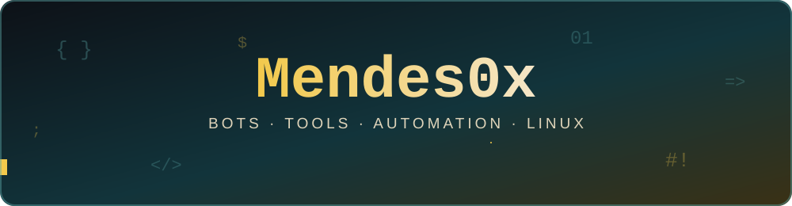

<div align="center">




<br />

<a href="https://mendes0x.github.io/My-portfolio/"></a>
<a href="https://github.com/Mendes0x?tab=repositories"></a>
<a href="#-contact"></a>

<br /><br />


<br /><br />

<a href="#-about"></a>
<a href="#-focus-areas"></a>
<a href="#-featured-projects"></a>
<a href="#-tech-stack"></a>
<a href="#-achievements"></a>
<a href="#-activity"></a>
<a href="#-contact"></a>

</div>

---

## 📖 About

<table>
<tr>
<td width="60%" valign="top">

Most of my projects start with a practical problem. I turn small ideas into useful tools, keeping interfaces clear and code straightforward.

| | |
|---|---|
| 🌎 **Based in** | Brazil |
| ⚙️ **Main stack** | JavaScript · Node.js · HTML/CSS · Bash |
| 🐧 **Environment** | Linux, from the terminal to server management |
| 🎯 **Approach** | Build thoughtfully · keep it simple · improve continuously |

</td>
<td width="40%" valign="top">

```bash
$ whoami
mendes0x

$ cat focus.txt
bots
automation
linux tools
web apps

$ ./keep_building.sh
> status: online ✔
```

</td>
</tr>
</table>

## 🧭 Focus Areas

<table>
<tr>
<td align="center" width="33%">
<h3>🌐 Web &amp; Backend</h3>
Responsive sites, Node.js applications and APIs
</td>
<td align="center" width="33%">
<h3>🤖 Bots &amp; Automation</h3>
Discord bots, dashboards and tools that simplify everyday tasks
</td>
<td align="center" width="33%">
<h3>🐧 Linux &amp; Servers</h3>
Server management, terminal utilities and network diagnostics
</td>
</tr>
</table>

## 🚀 Featured Projects

<div align="center">

<a href="https://github.com/Mendes0x/web-site-dowloader-mp3"></a>
<a href="https://github.com/Mendes0x/bot-framework-dashboard"></a>
<a href="https://github.com/Mendes0x/vpn-tor"></a>
<a href="https://github.com/Mendes0x/Network-Toolkit"></a>
<a href="https://github.com/Mendes0x/youtube-downloader"></a>

</div>

<details>
<summary><b>📋 Project overview (click to expand)</b></summary>
<br />

| Project | Category | Stack |
|---|---|---|
| 📼 **MediaDock** — media downloader with background jobs, live progress and file library | Web app | Node.js · Express · yt-dlp |
| 🤖 **Bot Framework Dashboard** — Discord bot status, metrics, commands and modules | Bots | JavaScript · Node.js · Express |
| 🔒 **VPN Manager** — manages OpenVPN and NetworkManager connections | Linux utility | Bash · Linux · OpenVPN |
| 🌐 **Network Toolkit** — menu-based diagnostics for Termux and Debian/Ubuntu | Networking | Bash · Nmap · Linux |
| 🎬 **Auto YouTube Downloader** — interactive video and audio downloader | CLI tool | Bash · yt-dlp · FFmpeg |

</details>

## 🧰 Tech Stack

<table>
<tr>
<td width="22%"><b>Languages</b></td>
<td></td>
</tr>
<tr>
<td><b>Backend</b></td>
<td></td>
</tr>
<tr>
<td><b>Databases</b></td>
<td>


</td>
</tr>
<tr>
<td><b>Systems &amp; Networking</b></td>
<td><br />


</td>
</tr>
<tr>
<td><b>Tooling</b></td>
<td><br />


</td>
</tr>
</table>

<details>
<summary><b>🔧 Tools &amp; utilities (click to expand)</b></summary>
<br />


</details>

## 🏆 Project Highlights

<div align="center">

<a href="https://github.com/Mendes0x/elaria"></a>
<a href="https://github.com/Mendes0x/bot-framework-dashboard"></a>
<a href="https://github.com/Mendes0x/Network-Toolkit"></a>

</div>

## 📊 Activity

<div align="center">
  
</div>

<br />

<div align="center">
  
  
</div>

<br />

<div align="center">
  
</div>

<br />

<div align="center">
  
</div>

## 📫 Contact

<div align="center">

Open to collaborations and business inquiries.

<a href="https://mendes0x.github.io/My-portfolio/"></a>
<a href="mailto:renegadothedev001@gmail.com"></a>

<br /><br />

*Always learning. Always building.*

</div>


